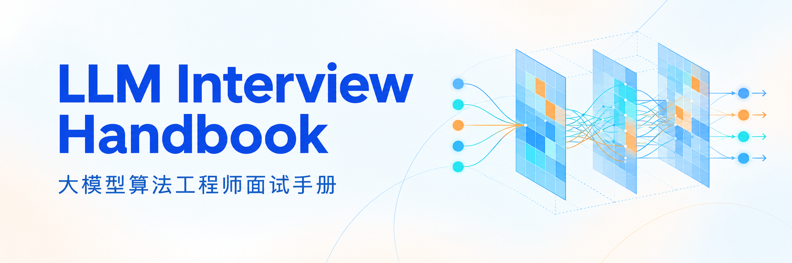

<h1 align="center">
  
</h1>

  
  
  

面向大模型算法工程师的面试复习资料，整理知识问答、模型组件实现与通用算法题解。知识部分涵盖模型架构、训练与后训练、推理优化、RAG、Agent 和多模态；代码部分提供 LLM 组件手撕、数据结构与算法题，以及面试真题的参考解法。

各章按专题组织，可直接查阅具体问题。除参考答案外，也讨论设计动机、公式推导与实现中的易错点。

  <a href="#大模型知识">大模型知识</a> ·
  <a href="#llm-手撕">LLM 手撕</a> ·
  <a href="#算法手撕">算法手撕</a> ·
  <a href="algorithms/11-interview-real-questions.md">面试真题</a> ·
  <a href="#重点追问">重点追问</a> ·
  <a href="#贡献与验证">参与贡献</a>

## 内容目录

### 大模型知识

从基础原理到训练、后训练、推理与应用，重点说明设计动机、数学推导和适用边界。

| 章节 | 核心内容 |
| :--- | :--- |
| [00 · 基础知识](docs/00-foundations.md) | 概率统计、机器学习基础 |
| [01 · 模型架构](docs/01-architecture.md) | Transformer、Attention、位置编码、归一化 |
| [02 · 训练方法](docs/02-training.md) | 优化器、混合精度、分布式训练、数据配比与计算预算 |
| [03 · 微调方法](docs/03-fine-tuning.md) | LoRA / QLoRA、SFT、标签掩码、Packing |
| [04 · 后训练与对齐](docs/04-alignment.md) | PPO / DPO / GRPO / DAPO / GSPO / GDPO、奖励设计与信用分配 |
| [05 · 推理优化](docs/05-inference.md) | KV Cache、在线 Softmax、投机解码、量化与解码 |
| [06 · 检索增强生成](docs/06-rag.md) | RAG 索引、检索、重排与进阶方法 |
| [07 · 智能体](docs/07-agent.md) | ReAct、工具调用、多智能体协作 |
| [08 · 多模态](docs/08-multimodal.md) | CLIP、BLIP、LLaVA、Diffusion |
| [09 · 模型评测](docs/09-evaluation.md) | 基准、Judge 校准、配对统计、置信区间、去污染与复现 |
| [10 · 系统与部署](docs/10-system.md) | 显存估算、服务化、算术强度、延迟与吞吐 |
| [99 · 前沿专题](docs/99-frontier.md) | DLM、Mamba、推理时扩展 |

### LLM 手撕

用 PyTorch 理解模型组件，关注张量形状、梯度、数值稳定性和实现边界。使用方式见 [LLM 手撕题集](llm-coding/README.md)。

| 章节 | 核心内容 |
| :--- | :--- |
| [01 · 注意力机制](llm-coding/01-attention.md) | Scaled Dot-Product、MHA、Causal Mask、GQA、KV Cache |
| [02 · 位置编码](llm-coding/02-position-encoding.md) | Sinusoidal、RoPE、ALiBi |
| [03 · 归一化](llm-coding/03-normalization.md) | LayerNorm、RMSNorm、BatchNorm 对比、Pre/Post-Norm |
| [04 · 分词器](llm-coding/04-tokenizer.md) | BPE 训练、编码与词频统计 |
| [05 · 解码策略](llm-coding/05-decoding.md) | Greedy、Top-k / Top-p、Beam Search、重复惩罚 |
| [06 · 参数高效微调](llm-coding/06-peft.md) | LoRA、QLoRA Linear、Adapter |
| [07 · 损失与强化学习](llm-coding/07-loss-rl.md) | CE、DPO、PPO、GRPO、Reward Model、多奖励归一化 |
| [08 · 其他核心组件](llm-coding/08-misc.md) | MoE、分块 Attention（教学版）、权重共享、梯度技巧 |

### 算法手撕

按数据结构与解题模式整理，包含通用算法、Hot100 和独立的面试真题章节。刷题说明见 [算法题集](algorithms/README.md)。

| 章节 | 核心内容 |
| :--- | :--- |
| [01 · 数组](algorithms/01-array.md) | 二分、双指针、滑动窗口、前缀和 |
| [02 · 链表](algorithms/02-linked-list.md) | 反转、双指针、环形与相交 |
| [03 · 哈希表](algorithms/03-hash-table.md) | 数组哈希、集合、映射 |
| [04 · 字符串](algorithms/04-string.md) | 反转、KMP、重复子串 |
| [05 · 栈与队列](algorithms/05-stack-queue.md) | 互相实现、单调队列、优先队列 |
| [06 · 二叉树](algorithms/06-binary-tree.md) | 深度优先遍历、层序遍历、路径问题 |
| [07 · 回溯](algorithms/07-backtrack.md) | 组合、切割、子集、排列 |
| [08 · 单调栈](algorithms/08-monotonic-stack.md) | 每日温度、接雨水、柱状图 |
| [09 · 动态规划](algorithms/09-dp.md) | 基础递推、背包、子序列 |
| [10 · Hot100](algorithms/10-hot100.md) | LeetCode Hot100 重点题 |
| [11 · 面试真题](algorithms/11-interview-real-questions.md) | LeetCode 原题、算法变体、机器学习与大模型题 |
| [99 · Python 与面试技巧](algorithms/99-tips.md) | Python 易错点、输入输出模板 |

## 重点追问

从「记住结论」再往前一步：解释原因、明确假设，并能讨论替代设计。

### 基础与微调

- [LoRA 初始化能否反过来？首步梯度和有效更新有什么不同？](docs/03-fine-tuning.md#q01--lora-原理)
- [交叉熵为什么取负对数？为什么梯度是预测减目标？](docs/02-training.md#q01--损失函数)
- [LayerNorm 的方差为什么除以 n？BatchNorm 与 RMSNorm 有何区别？](docs/01-architecture.md#q06--layernorm--rmsnorm--prepost-norm)
- [SFT 的 attention mask、loss mask 和 packing 边界有什么区别？](docs/03-fine-tuning.md#q07--sft-数据到监督信号的完整链路)

### 训练与奖励设计

- [变长 microbatch 为什么不能直接平均 loss？](docs/02-training.md#q09--有效-token梯度累积与精确续训)
- [GRPO 按回答平均和按 token 平均为何不同？](llm-coding/07-loss-rl.md#q05--grpo)
- [奖励怎样经过优势、ratio 和 clipping 变成策略梯度？](docs/04-alignment.md#q13--从-rollout-到一次策略更新)
- [奖励归一化为什么不能代替硬约束？](docs/04-alignment.md#q14--奖励尺度约束与信用分配)

### 推理与评测

- [KV Cache 如何避免未来信息泄漏？](llm-coding/01-attention.md#q05--kv-cache-推理加速)
- [投机解码拒绝后的残差分布为什么正确？](docs/05-inference.md#q05--speculative-decoding-投机解码)
- [评测提升是否超过抽样噪声？](docs/09-evaluation.md#q06--提升是否可信配对比较与置信区间)
- [吞吐提高为什么不代表每个请求延迟降低？](docs/10-system.md#q06--从算术强度到延迟与吞吐)

## 贡献与验证

欢迎纠错、补充追问、完善解法或提供可核对的参考资料。提交前请阅读 [贡献指南](CONTRIBUTING.md)，新增内容可参考 [知识题模板](docs/_TEMPLATE.md) 与 [算法题模板](algorithms/_TEMPLATE.md)。

仓库提供文档静态检查、公式解析与部分代码回归测试，运行方式及覆盖范围见 [测试说明](tests/README.md)。教学示例不等同于生产实现，检查通过也不代表所有示例和 GitHub 公式渲染都已验证。

本项目采用 [MIT License](LICENSE)。

## Star History

<a href="https://www.star-history.com/#axiaoquan/llm-interview-handbook&amp;Date">
  <picture>
    <source media="(prefers-color-scheme: dark)" srcset="https://api.star-history.com/svg?repos=axiaoquan/llm-interview-handbook&amp;type=Date&amp;theme=dark" />
    <source media="(prefers-color-scheme: light)" srcset="https://api.star-history.com/svg?repos=axiaoquan/llm-interview-handbook&amp;type=Date" />
    
  </picture>
</a>
